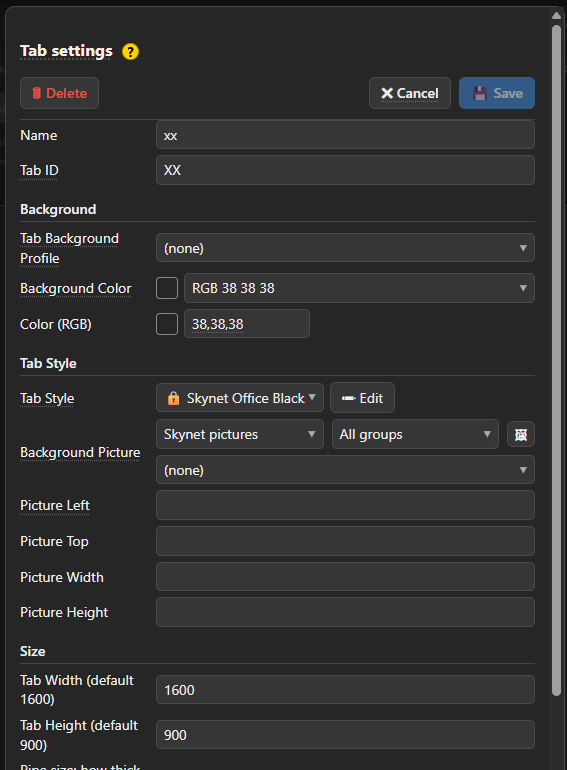
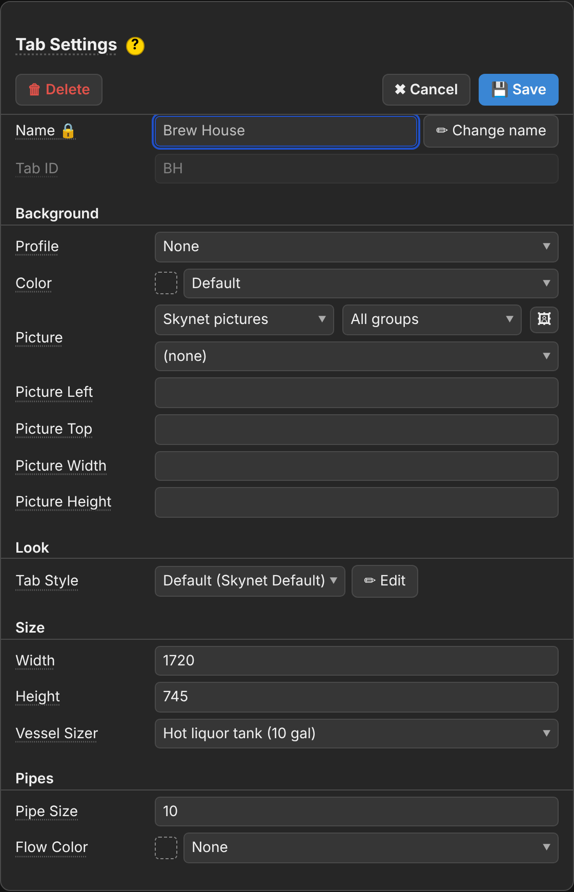

# Dialog Model Learning: Tab Settings

The first dialog updated to the **Blichmann RipTide Dialog 1** model with no markup first (OakBarn Brewery, 2026-11-15: "Update
this tab using Blickmann Dialog 1 Model. I want you to do without my input and I will see the results after the next big exe. Keep
the original, your changes, and later my more detailed correction to you attempt. to see if we can improve your updating").

This page keeps three things, so each later auto-update can be compared with what OakBarn Brewery wanted:

1. **The original**: the dialog as it was.
2. **The changes**: what was changed, and the reason for each.
3. **OakBarn Brewery's corrections**: left empty, for the detailed corrections after the next big Setup .exe.

At the end, **Lessons** gathers what the corrections teach, for the next dialog.

---

## 1. The original

OakBarn Brewery's screenshot of the original dialog (the top part; the rest scrolled below it):

Every field of the original, top to bottom, as the code had it (public/app.js, `editWorkspace`, before this PR):

| # | Field name on the dialog | Kind | Notes on the original |
|---|---|---|---|
| | Title **Tab settings** | | Title not in Title Case. Delete, Cancel, Save at the top **and** at the bottom. |
| 1 | **Name** | text | A saved Tab: Name 🔒 with ✏ Change name. |
| 2 | **Tab ID** (follows Rule 3.2; once saved it never changes) | text | A saved Tab: "Tab ID (saved: it never changes, Rule 3.2)", read only. The ( ) words moved to its Hover Help by themselves. |
| | *Background* (heading) | | |
| 3 | **Tab Background Profile** (its background color, and the look new devices and widgets here start with) | dropdown | 3 words. First choice **(none)**. |
| 4 | **Background color** (Default = the Tab Background Profile's) | color | 2 words, plus the Color (RGB) row for a Custom color. |
| | *Tab Style* (heading) | | |
| 5 | **Tab Style** (Label and Device or Widget colors, fonts and sizes) | Style list + ✏ Edit | First choice **(the Default tab's Style: ...)**: long. |
| | note | | "Only a Device or Widget with no color ... ➕ Add new User Style… makes your own." |
| 6 | **Background picture** | picture picker | Sat under *Tab Style*, though it is part of the background. |
| | note | | "The list shows the pictures in media/Images ... fill them in to place it at a spot and size." |
| 7-10 | **Picture left**, **Picture top**, **Picture width**, **Picture height** | number | No Hover Help of their own (the note above went to the first one). |
| | *Size* (heading) | | |
| 11 | **Tab width (default 1600)** | number | The default written in the name. |
| 12 | **Tab height (default 900)** | number | The same. |
| 13 | **Pipe size: how thick a 1/2" pipe is drawn on this tab (default 10). Other pipe and hose sizes, reducers and fittings scale from it** | number | A whole sentence as the name (it wrapped onto 3 lines). |
| 14 | **Master Vessel Sizer: resize this Vessel and every Vessel on the Tab follows (None = no Vessel can be resized)** | dropdown | A sentence as the name. |
| | *Flow Color* (heading) | | |
| 15 | **Flow Color of every pipe and hose on this Tab** (tab.flow_Color in a Process) | Flow Color list | First choice **None (each pipe keeps its own Flow color)**: long. Its Color (RGB) row always showed, even with None picked. |
| | note | | "Mash, Boil, Whirlpool and Ferment: ... A Process line tab.flow_Color = Mash sets it on the Tab the screen shows." |

How it behaved:

- **Enter** went field to field down the whole box (Rule 18.20), the last one to Save.
- **Tab** went through everything, the buttons too (Delete, Cancel, Save, ? Help).
- The focus started wherever the browser put it.
- **Save with a blank Name or a bad Tab ID** closed the box with a red message, and **everything typed was lost**.
- **✏ Change name** on a saved Tab turned spaces into _ (Brew House became Brew_House).

---

## 2. The changes (PR "Tab Settings to the Blichmann RipTide Dialog 1 model")

The new dialog:

| # | Change | Why (the model or Rule it follows) |
|---|---|---|
| 1 | Title **Tab Settings** | Title Case for dialog titles (Rule 18.34). |
| 2 | **Delete, Cancel and Save frozen at the top**; no bottom row | The frozen top of the model (Rule 2.51: "Apply the Freeze to any dialog that is updated"). |
| 3 | Field names cut to 1 or 2 words: **Name**, **Tab ID**, **Profile**, **Color**, **Picture**, **Picture Left / Top / Width / Height**, **Tab Style**, **Width**, **Height**, **Vessel Sizer**, **Pipe Size**, **Flow Color** | KISS: a label is 1 or 2 words (Rule 11.8); Title Case (Rule 18.34). Under the *Background* heading, "Profile" and "Color" need no "Background". |
| 4 | Every field has **its own Hover Help** on its name, written plain English first and, where needed, "The technical side" after (Flow Color) | Rules 2.38, 11.8; the Hover Help model. Picture Left, Top, Width and Height each got their own, which they did not have. |
| 5 | The three notes on the dialog are gone; their words are in the Hover Help | Rule 2.38: no explanations on the dialog. |
| 6 | Headings regrouped: **Background** (Profile, Color, Picture and its place), **Look** (Tab Style), **Size** (Width, Height, Vessel Sizer), **Pipes** (Pipe Size, Flow Color) | The Picture was under *Tab Style* but belongs to the background. A heading *Flow Color* over a field *Flow Color* said the same thing twice. |
| 7 | Short dropdown choices: Profile **None** (was "(none)"), Tab Style **Default (Skynet Default)** (was "(the Default tab's Style: ...)"), Flow Color **None** (was "None (each pipe keeps its own Flow color)") | Rule 2.38 item 1: short, plain choices; what a choice does goes in the Hover Help. |
| 8 | Width, Height and Pipe Size show their Skynet number when empty (1600, 900, 10), not "(default ...)" in the name | Rule 18.36: a box with a Skynet default shows that number. |
| 9 | **Order of focus**, like Rule 18.38: the **Name** has the focus when the box opens. **Enter** goes only between the key boxes, **Name** and **Tab ID** ("All"); every other box is reached by the **Tab key or the mouse** ("TMF"); a saved Tab ID gets **no focus** ("NF"). Enter on a blank Name stays on it; from any other box Enter goes back to the Name. | The Dialog 1 focus order. The Name and Tab ID are this dialog's Label and Port: what the user must give. |
| 10 | The **Tab key** cycles through the boxes only, the last back to the first; ? Help, Delete, Cancel and Save are for the mouse | Rule 18.38: "? Help, ✖ Cancel and ➕ Add Device are not in the cycle". |
| 11 | A blank Name, a bad Tab ID or one already used **only stops Save**: the small ⚠ box says why, the box gets the focus, the ⚠ box goes away after 5 seconds, and nothing typed is lost. Everything else can still be reached. | Rule 18.28 as changed 2026-11-15 (only Save waits). The old way closed the box and lost the work. |
| 12 | A new Tab's **Tab ID follows its Name** until one is typed (Fermentation Room gives FR); typed letters become capitals | Rule 3.2: "Skynet always suggests a unique one ... The user may type another before the first Save". Like the live example ID of the Add Interface box. |
| 13 | Tab ID Hover Help says it **follows Rule 3.2** instead of repeating the details | Rule 3.2: "Other Rules, Help pages and Hover Help do not repeat these details: they say the ID follows Rule 3.2". |
| 14 | **✏ Change name** on a saved Tab keeps spaces (Brew House stays Brew House) | A Tab's name is a shown name (public/names.js: Tab and Interface names may have spaces). Found while testing. |
| 15 | Flow Color's **Color (RGB)** row shows only while RGB is picked | Rule 2.48, like a Color's Custom. It always showed before (on pipes, IPs and vessels too, the same list). |
| 16 | Help 26 rewritten as the **Tab Settings** page, with the same words as the Hover Help, then "The technical side"; Help 36, 101 and 135 name the new boxes; all in French too | Hover Help = Panel Help (Rule 11.4); French Help in the same PR (Rule 11.11). |

Not changed, on purpose:

- **No Rule was changed.** Where a Rule seemed to get in the way, it is listed under *Open questions* below.
- The **⚙ Tab settings** button on the Edit layout bar keeps its name (it is not part of the dialog).
- The shared **Picture** picker (Skynet pictures / All groups / (none)) is the same in every dialog; its "(none)" was left alone.
- The **New tab** name prompt (a plain browser box) was not touched.

### Open questions (where a Rule seemed to get in the way)

1. **Rule 18.20 vs the Dialog 1 focus order.** Rule 18.20 says Enter "jumps to the next field (from the last field to the Save
   button)" in every dialog; its only exceptions are a new Device and the Pump (Rule 18.38). This dialog now uses the Dialog 1 order
   instead, because that is what was asked for. Pick one: **change Rule 18.20** so every dialog updated to the model takes the
   Dialog 1 order, or keep this as a **Tab Settings exception**, or put Enter back the old way here.
2. **Rule 18.38 says "The Pump first; the other Device dialogs follow once the Pump dialog, the model, is done."** Tab Settings is not
   a Device dialog, and it was asked for by name, so it was done now.
3. **Rule 2.51** lists the dialogs done so far (the Pipe and Hose Properties ...). Tab Settings could be added to that list.
4. **"Master Vessel Sizer" (Rule 19.3) is 3 words.** The box is now **Vessel Sizer** (Rule 11.8: 1 or 2 words) and its Hover Help
   starts "The Master Vessel Sizer". Keep it, or allow the 3-word name as an exception?
5. **Enter never reaches Save** here (as in the Pump Add box). If you want Enter on the Tab ID to Save, say so.

---

## 3. OakBarn Brewery's corrections

*(Left empty for the detailed corrections after the next big Setup .exe. Number each one; the reply will list each item as done.)*

| # | What to correct | OakBarn Brewery's words |
|---|---|---|
| | | |

---

## Lessons for the next auto-update

*(Filled in once the corrections above are in: what the auto-update got right, what it got wrong, and the pattern to follow next
time.)*
